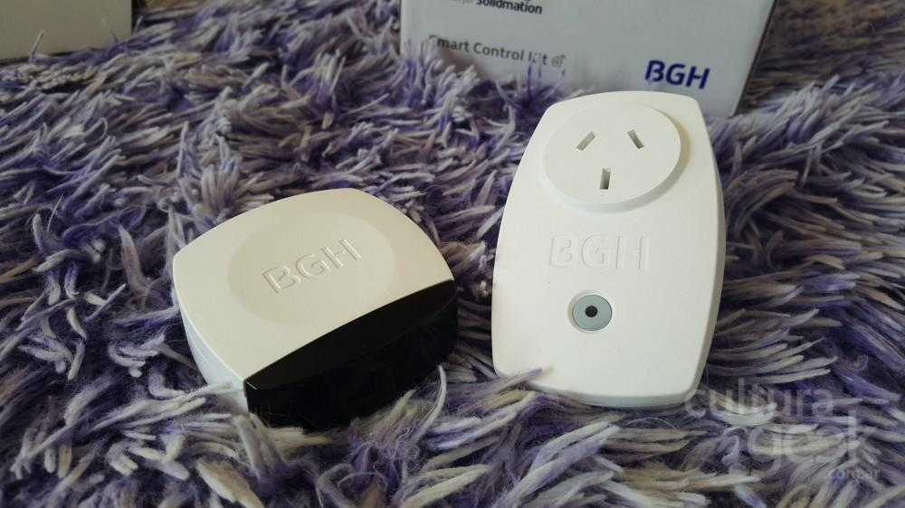
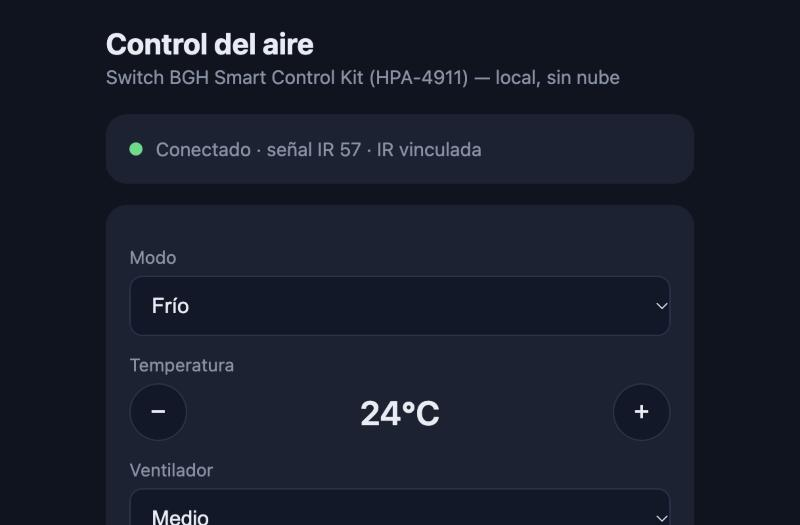
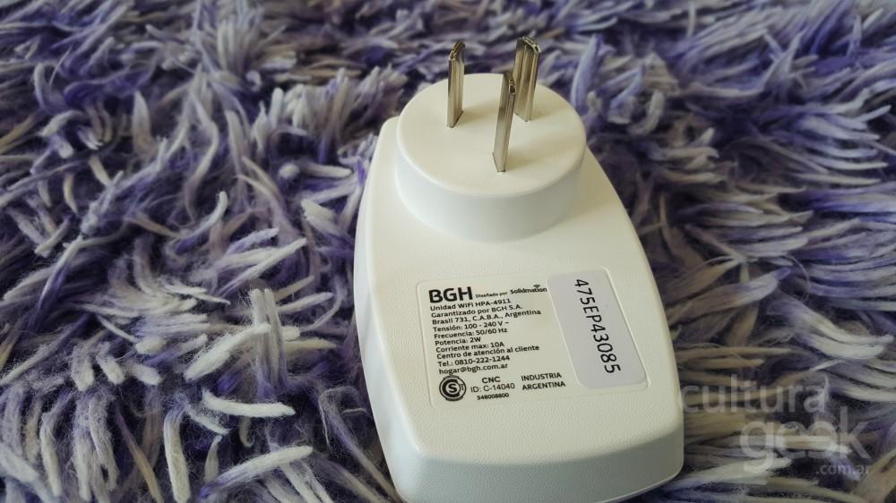

# 🔌 BGH Smart Control Kit — resucitado, sin nube y sin pedir permiso

Foto: [review de Cultura Geek](https://culturageek.com.ar/review-del-bgh-smartcontrol/) (2016) — el mismo kit que vas a tener en un cajón.

Tenía uno de estos juntando polvo. BGH le cortó el soporte a su app en
diciembre de 2025, así que este ladrillito blanco pasó de "controlar el
aire desde el celular" a "pisapapeles caro" de un día para el otro. Clásico.

Lo abrí para ver qué tenía adentro, y terminé reconstruyendo el protocolo
entero a las 11 de la noche en vez de tirarlo. Esto es lo que quedó: un
panel web que corre en tu propia Mac y le habla directo al equipo por WiFi,
sin la app, sin la nube, sin que nadie en BGH se entere.

## Cómo llegamos acá (la posta del debugging)

Por si te sirve de algo — o por si simplemente te causa gracia el nivel de
tozudez necesario:

1. **Lo abrí.** Adentro: un módulo WiFi con el chip pintado a propósito
   (gracias, BGH), un chip Bluetooth CSR1010 y un sensor de consumo.
   Googlear el modelo no dio nada.
2. **Probé el login web de fábrica.** `admin`/`admin` y las 8 combinaciones
   de siempre. Nada, 401 por todos lados.
3. **El equipo sí respondía a un beacon UDP** (puerto 48899, el típico de
   los módulos Hi-Flying), pero no aceptaba ningún comando `AT+`. BGH le
   había cortado las piernas a la interfaz de configuración estándar.
4. **A buscar en GitHub.** Y ahí apareció: alguien (gracias,
   [firtman](https://github.com/firtman/bgh_smart)) ya había reconstruido
   el protocolo completo — sin clave, sin login, todo por UDP en la red
   local. El "login" de fábrica era un cebo. La posta estaba en otro lado.
5. **Primer intento de mandarle el WiFi: tipeé literal los placeholders**
   del ejemplo (`TU_RED`, `TU_CLAVE`) en vez de reemplazarlos. El equipo lo
   aceptó feliz y se puso a buscar una red que no existe. Jamás confíes en
   mí a la una de la mañana.
6. **Ya con la red bien, el aire no reaccionaba.** El equipo mandaba la
   orden (se veía perfecto en los logs de debug: `MODE_COOL 24°`), pero
   entre la base y la unidad IR se repetía `BLE NAK` + `Retry IR-Play
   packet..` en loop.
7. **Sospeché de las pilas.** Eran nuevas. Sospeché mal.
8. **El verdadero culpable:** la unidad IR estaba mal posicionada después
   de mover la base de lugar. La reacomodé un poco y — beep — prendió.

Foto: Cultura Geek. Sí, es el mismo modelo que anda dando vueltas en tu casa.

Moraleja: cuando todo el protocolo está bien y nada funciona, antes de
sospechar del software, movelo dos centímetros.

## Qué hace

- **Prender / apagar, modo, temperatura, ventilador** — control real del
  aire, por tu propio WiFi.
- **Asistente de primera configuración con botones**: conectar el equipo
  a tu WiFi, vincular la unidad IR, y "enseñarle" tu control remoto
  (detecta el código infrarrojo solo, con que apretes ENCENDIDO alcanza).
- Sirve para **cualquier marca** — el protocolo IR se detecta al vuelo.
- Pensado para alguien **no técnico**: doble clic y listo, nada de
  terminal.

## Instalación

1. Descargá o cloná este repo.
2. Doble clic en **`Abrir Control del Aire.command`**.
   *(La primera vez, macOS va a decir que es de un "desarrollador no
   identificado" — es normal, nadie lo firmó. Click derecho → Abrir →
   Abrir, y listo, solo hace falta una vez.)*
3. Se abre el panel en `http://localhost:8765`. Si es la primera vez que
   configurás este equipo, el asistente te guía paso a paso.

## Requisitos

- Mac con Python 3 (viene de fábrica).
- El switch BGH Smart Control Kit (HPA-4911), con pilas nuevas en la
  unidad IR.
- WiFi de **2,4 GHz** — el equipo no entiende 5 GHz, ni se moleste en
  intentarlo.

## Cómo está armado

- `ac_control.py` — el protocolo en sí: descubrimiento, control del aire,
  provisioning de WiFi, aprendizaje del código IR. Python puro, cero
  dependencias.
- `ac_server.py` — servidor HTTP local (librería estándar nomás) que
  expone todo eso como una API, con algo de endurecimiento contra CSRF y
  DNS rebinding porque sí, aunque sea para tu propia casa.
- `ac_web/` — el panel, una página HTML con botones.

## Créditos

La base del protocolo sale de [firtman/bgh_smart](https://github.com/firtman/bgh_smart)
y de lo que compartió la comunidad en sus issues. Este repo lo empaqueta
en algo que cualquiera pueda usar con un doble clic.

## Licencia

MIT. Usalo, rompelo, arreglalo, contame si te funcionó.
